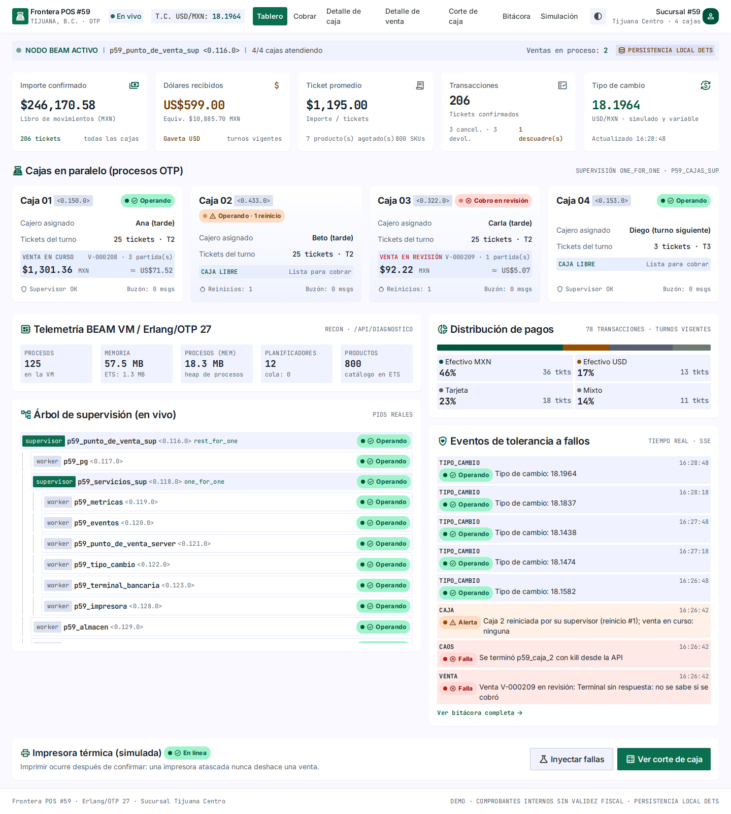
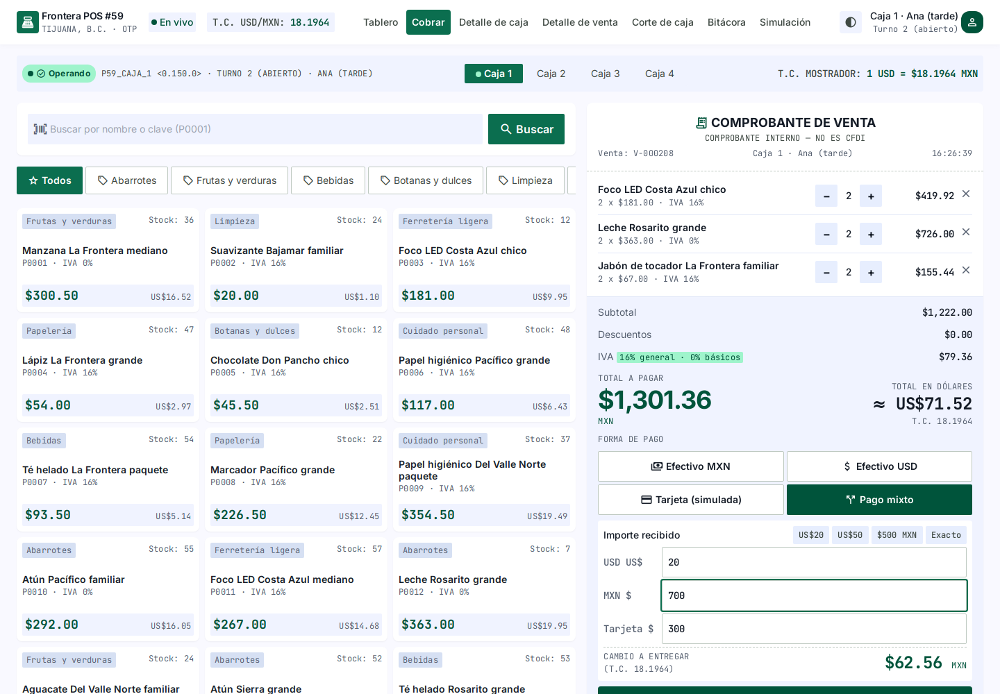
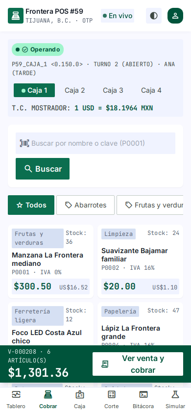
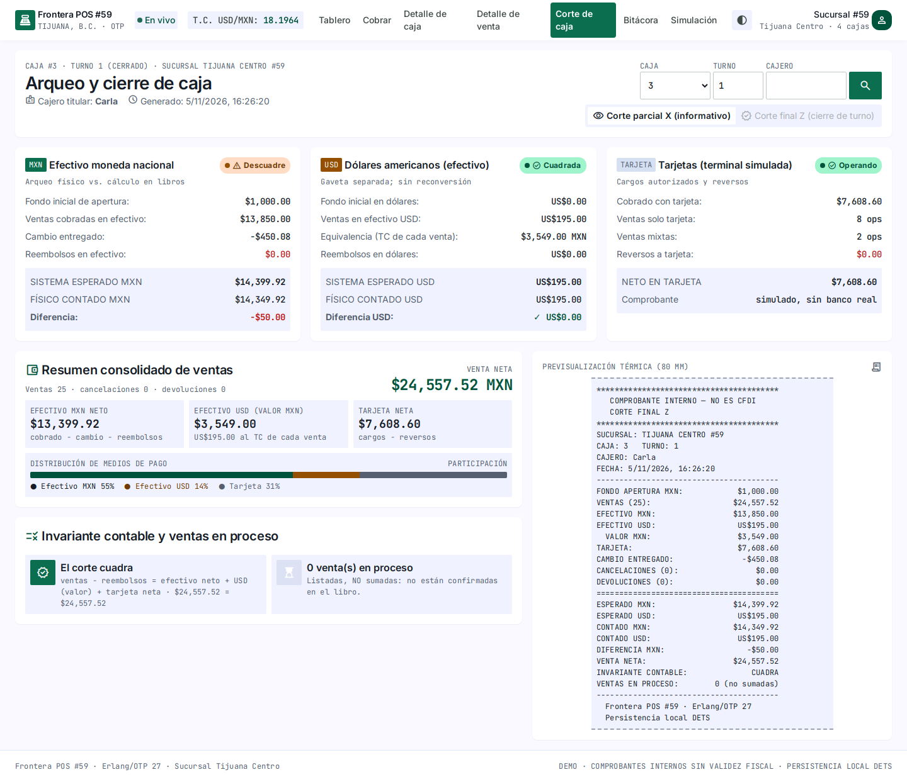
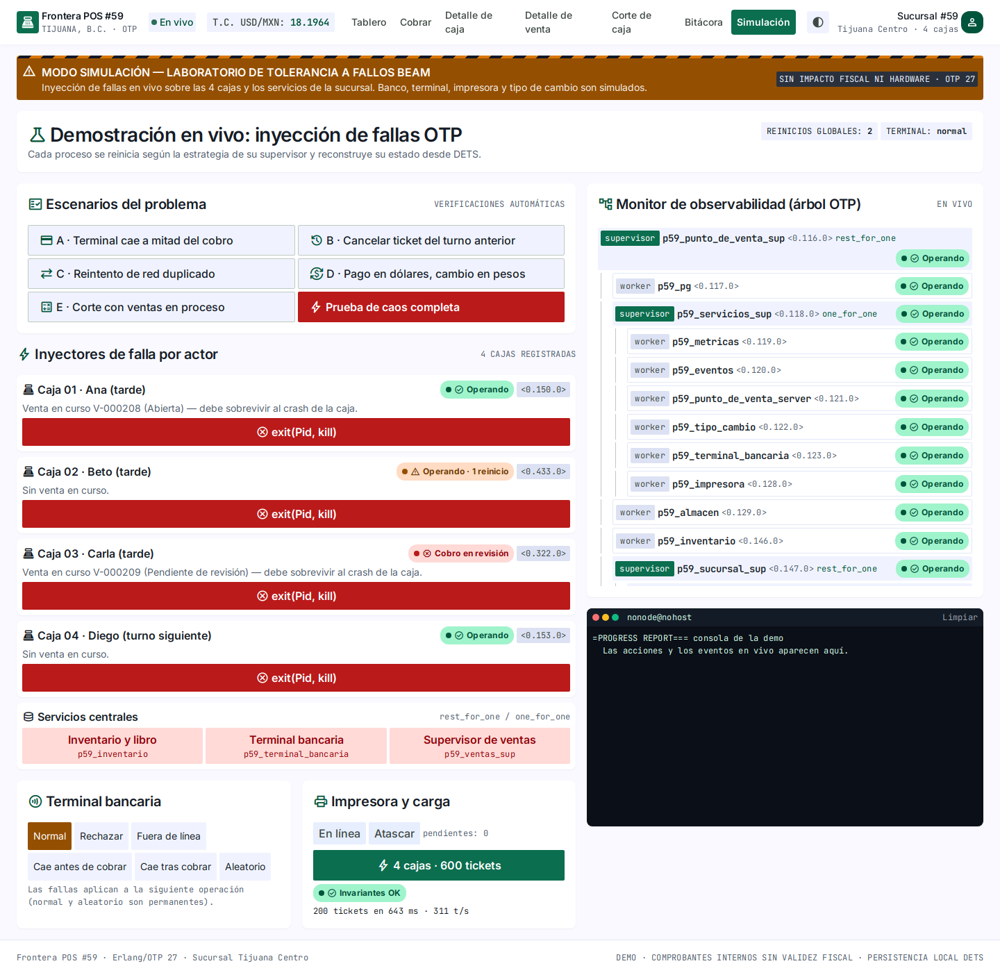
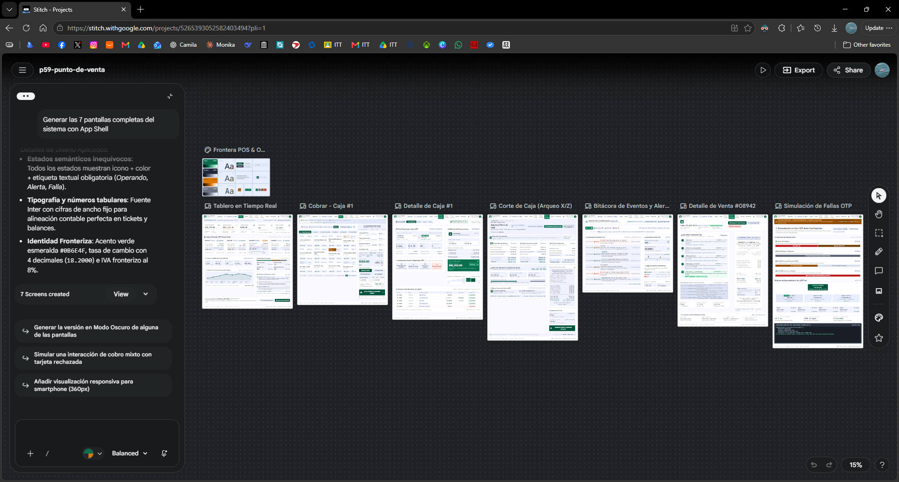

# Manual de uso — Punto de venta #59 (Erlang/OTP)

> Proyecto #59 · Programación Lógica y Funcional · Ingeniería en Sistemas
> Computacionales · Instituto Tecnológico de Tijuana. Etapa: **DEMO**.
> Repositorio: <https://github.com/KokovsTheWorld/p59-punto-de-venta>.

## Índice

1. [Descripción](#1-descripción)
2. [Objetivo](#2-objetivo)
3. [Requisitos del entorno](#3-requisitos-del-entorno)
4. [Instalación](#4-instalación)
5. [Configuración](#5-configuración)
6. [Compilación y pruebas](#6-compilación-y-pruebas)
7. [Ejecución](#7-ejecución)
8. [Acceso a la interfaz](#8-acceso-a-la-interfaz)
9. [Funcionalidades](#9-funcionalidades)
10. [Ejemplos de uso (guion de la demo)](#10-ejemplos-de-uso-guion-de-la-demo)
11. [Ejemplos de operaciones HTTP](#11-ejemplos-de-operaciones-http)
12. [Simulación de 600 tickets](#12-simulación-de-600-tickets)
13. [Prueba de caos](#13-prueba-de-caos)
14. [Solución de problemas comunes](#14-solución-de-problemas-comunes)
15. [Limitaciones conocidas](#15-limitaciones-conocidas)
16. [Evidencias](#16-evidencias)

---

## 1. Descripción

Sistema de punto de venta para una tienda de Tijuana con **4 cajas
registradoras** que cobran al mismo tiempo sobre un **inventario compartido de
800 productos**. Acepta **pesos (MXN), dólares (USD) con tipo de cambio
variable, tarjeta y pagos mixtos**. Emite tickets, permite cancelaciones y
devoluciones con trazabilidad, y genera el **corte de caja** por caja, turno y
cajero.

Está construido con **Erlang/OTP**. Cada caja y cada venta es un proceso
independiente vigilado por supervisores. Si un proceso falla, se reinicia solo
y retoma su trabajo desde el disco, sin perder ventas confirmadas.

> ⚠️ Es una demo académica. La terminal bancaria, el banco, la impresora y el
> tipo de cambio son **simulados**. El ticket es un **comprobante interno y no
> es un CFDI 4.0**: no hay timbrado ni conexión con el SAT ni con un PAC.

## 2. Objetivo

Demostrar cómo Erlang/OTP resuelve un punto de venta concurrente:

- No vender más de lo que hay aunque 4 cajas cobren a la vez.
- No perder una venta confirmada aunque se caiga un proceso.
- No registrar dos veces una venta cuando la red reintenta.
- Calcular importes, IVA, descuentos, dólares y cambio al centavo.
- Hacer cortes de caja que siempre cuadren, incluso con ventas a medias.

## 3. Requisitos del entorno

| Componente | Versión probada | Notas |
|---|---|---|
| Windows 10/11 con **WSL2** | WSL 2 (kernel 6.18) | Entorno de ejecución definido para la demo |
| **Ubuntu** en WSL | 26.04.1 LTS | Funciona igual en Ubuntu/Debian nativo |
| **Erlang/OTP** | 27.3.4.6 | Necesita los módulos `crypto`, `ssl`, `inets` y `public_key` |
| **rebar3** | 3.28.0 | Compilación, pruebas y release |
| curl | cualquiera | Para probar la API |
| Navegador | Chrome, Edge o Firefox | En Windows abre `http://localhost:8059` (no necesita Internet) |

No se necesita base de datos ni servicios externos: los datos se guardan en
archivos **DETS** locales.

## 4. Instalación

### 4.1 Erlang/OTP 27

**Opción A — paquetes de Ubuntu (recomendada si tienes sudo):**

```bash
sudo apt update
sudo apt install -y erlang-nox erlang-dev curl
erl -noshell -eval 'io:format("~s~n",[erlang:system_info(otp_release)]), halt().'   # debe imprimir 27
```

**Opción B — sin sudo (como en el equipo de la demo):** extraer los paquetes
`.deb` de Ubuntu en una carpeta del usuario.

```bash
mkdir -p ~/debs && cd ~/debs
apt-get download erlang-base erlang-crypto erlang-ssl erlang-asn1 erlang-public-key \
  erlang-inets erlang-eunit erlang-syntax-tools erlang-tools erlang-runtime-tools \
  erlang-sasl erlang-parsetools erlang-mnesia erlang-os-mon erlang-dev
for f in *.deb; do dpkg-deb -x "$f" ~/.local/erlang; done
mkdir -p ~/.local/bin
ln -sf ~/.local/erlang/usr/lib/erlang/bin/{erl,erlc,escript} ~/.local/bin/
```

**Opción C — asdf:** `asdf plugin add erlang && asdf install erlang 27.3.4.6`.

### 4.2 rebar3 3.28

```bash
mkdir -p ~/.local/bin
curl -fsSL -o ~/.local/bin/rebar3 https://github.com/erlang/rebar3/releases/download/3.28.0/rebar3
chmod +x ~/.local/bin/rebar3
rebar3 version        # rebar 3.28.0 on Erlang/OTP 27
```

Si `~/.local/bin` no está en el `PATH`, agrega
`export PATH="$HOME/.local/bin:$PATH"` a `~/.bashrc`.

### 4.3 Código del proyecto

```bash
git clone https://github.com/KokovsTheWorld/p59-punto-de-venta.git ~/p59-punto-de-venta
cd ~/p59-punto-de-venta
```

La primera compilación descarga `cowboy 2.12.0` y `recon 2.5.6` desde Hex.

## 5. Configuración

Archivo `config/sys.config`:

| Parámetro | Valor por omisión | Significado |
|---|---|---|
| `puerto` | `8059` | Puerto HTTP (variable de entorno `P59_PUERTO`) |
| `data_dir` | `"data"` | Carpeta de los archivos DETS (`P59_DATA_DIR`) |
| `num_cajas` / `num_productos` | `4` / `800` | Tamaño de la sucursal |
| `semilla_catalogo` | `59` | Catálogo reproducible |
| `iva_general_pb` | `1600` | IVA en puntos base (16 %). **Usa `800` para la región fronteriza** si la tienda aplica el estímulo; verifica antes su vigencia en el DOF |
| `tipo_cambio_inicial` | `182000` | 18.2000 MXN/USD (simulado) |
| `tipo_cambio_variacion_ms` | `30000` | Cada cuánto varía el TC; `0` lo fija |
| `terminal_timeout_ms` | `3000` | Espera máxima a la terminal antes de mandar la venta a revisión |
| `fondo_inicial` | `100000` | Fondo de caja al abrir turno ($1,000.00) |

`config/vm.args` define el nombre del nodo (`p59_punto_de_venta@127.0.0.1`) y
la cookie. **Cambia la cookie** si el nodo se expone fuera de tu equipo.

## 6. Compilación y pruebas

```bash
rebar3 compile     # compila sin warnings (warnings_as_errors está activo)
rebar3 eunit       # 49 pruebas: cálculo, árbol, ventas, concurrencia, escenarios, caos, HTTP
```

Resultado esperado: `All 49 tests passed.`

## 7. Ejecución

### 7.1 Todo en un paso (recomendado para la demo)

```bash
scripts/demo.sh
```

Compila, corre las pruebas, genera el release, lo arranca en segundo plano y
muestra la URL.

### 7.2 Paso a paso con el release

```bash
rebar3 release
_build/default/rel/p59_punto_de_venta/bin/p59_punto_de_venta daemon    # en segundo plano
_build/default/rel/p59_punto_de_venta/bin/p59_punto_de_venta ping      # pong
_build/default/rel/p59_punto_de_venta/bin/p59_punto_de_venta remote_console   # consola (Ctrl+C dos veces para salir)
_build/default/rel/p59_punto_de_venta/bin/p59_punto_de_venta stop
```

Los datos del release quedan en `_build/default/rel/p59_punto_de_venta/data/`.
Para empezar desde cero, detén el release y borra esa carpeta.

### 7.3 Modo desarrollo

```bash
rebar3 shell          # arranca la app con consola interactiva (datos en ./data)
```

### 7.4 Servicio systemd (opcional)

En esta instalación de WSL systemd está activo (`systemctl is-system-running` →
`running`). Para que el release arranque solo:

```bash
mkdir -p ~/.config/systemd/user
cp scripts/systemd/p59-punto-de-venta.service ~/.config/systemd/user/
systemctl --user daemon-reload
systemctl --user enable --now p59-punto-de-venta
systemctl --user status p59-punto-de-venta
journalctl --user -u p59-punto-de-venta -f      # bitácora del servicio
```

La unidad supone el repositorio clonado en `~/p59-punto-de-venta`; edita las rutas si lo
tienes en otro lugar. Si WSL no tiene systemd, usa la sección 7.1.

## 8. Acceso a la interfaz

Abre **http://localhost:8059/** en el navegador de Windows. WSL2 reenvía
`localhost` automáticamente. Si no carga, revisa la sección 14.

La interfaz fue **diseñada en Google Stitch** (`design/stitch/`) e integrada con
la API real. Funciona sin conexión a Internet: estilos y fuentes se sirven desde
el propio servidor. En celular el menú pasa a una barra inferior. El botón
◐ del encabezado alterna el modo claro y el oscuro.

| Pantalla (menú) | Ruta | Para qué | Captura |
|---|---|---|---|
| Tablero | `#/` | KPIs del libro, 4 cajas con pid y semáforo (Operando / Alerta / Falla), telemetría BEAM (recon), distribución de pagos, eventos en vivo y árbol de supervisión con pids reales | `app-tablero.png`, `app-tablero-oscuro.png` |
| Cobrar | `#/cobrar/1` … `#/cobrar/4` | Catálogo con búsqueda y categorías, comprobante de venta, −/+ por partida, formas de pago (MXN, USD, tarjeta, mixto), vista previa del cambio | `app-cobrar.png`, `app-cobrar-celular.png`, `app-cobro-en-revision.png` |
| Detalle de caja | `#/caja/N` | Ficha del `gen_server` (pid, buzón, memoria, reducciones, reinicios), turno, efectivo esperado, transacciones recientes, "Simular crash (kill)" | `app-caja.png` |
| Detalle de venta | `#/venta`, `#/venta/V-…` | Línea de tiempo del `gen_statem`, ticket térmico, persistencia, cancelación y devolución | `app-venta-ticket.png` |
| Corte de caja | `#/corte[?caja=&turno=&cajero=]` | Arqueo X (informativo) y Z (cierre de turno), gavetas MXN/USD/tarjeta, invariante contable, ventas en proceso, ticket del corte | `app-corte.png` |
| Bitácora | `#/bitacora` | Eventos en tiempo real (SSE), filtros por nivel y origen, búsqueda, exportación CSV, reinicios por proceso | `app-bitacora.png` |
| Simulación | `#/simulacion` | Escenarios A–E, prueba de caos, `exit(Pid, kill)` por caja y servicio, modos de terminal e impresora, carga de 600 tickets, árbol OTP y consola | `app-simulacion.png` |

Las capturas están en `design/evidencias/` (tomadas con Chromium sobre el
sistema en ejecución).

**Tablero en tiempo real** (caja 2 reiniciada por su supervisor, caja 3 con un cobro en revisión):



**Cobrar** (pago mixto con vista previa del cambio) y **versión de celular**:





**Corte de caja** (turno cerrado con descuadre de −$50.00 detectado; invariante contable en verde):



**Simulación de fallas** (escenarios A–E, `exit(Pid, kill)`, árbol OTP en vivo):



**Diseño original en Google Stitch:**



## 9. Funcionalidades

- **Catálogo:** 800 productos generados de forma reproducible. Cada uno tiene
  clave, nombre, categoría, precio sin IVA, existencias y estado
  activo/inactivo. Abarrotes y frutas y verduras van a IVA 0 %; el resto, a la
  tasa general.
- **Cajas:** 4 cajas independientes, cada una con su turno, su cajero y una
  venta en curso.
- **Ventas:** agregar y quitar partidas (con descuento por partida), ver
  subtotal, IVA y total, cobrar o cancelar. Estados: `abierta`,
  `procesando_pago`, `pendiente_de_revision`, `pagada` y `cancelada`.
- **Pagos:**
  - Efectivo MXN.
  - Efectivo USD, valorado al tipo de cambio capturado al cobrar y registrado
    en el ticket.
  - Tarjeta simulada.
  - Mixto: tarjeta + USD + MXN.
  - El cambio siempre se entrega en pesos.
- **Tickets:** folio `T-000001`, partidas, descuentos, IVA, total, pagos, tipo
  de cambio, caja, cajero y fecha. Se pueden consultar después.
- **Cancelaciones y devoluciones:** son movimientos nuevos que referencian el
  ticket original; el ticket nunca se borra. Se reembolsa primero a tarjeta y
  después en efectivo MXN.
- **Corte de caja:** ventas por modalidad, efectivo esperado en MXN y en USD
  por separado, cancelaciones, devoluciones, contado, diferencia e
  **invariante contable** (verde = cuadra). Las ventas en proceso se listan
  aparte y no se cuentan.
- **Tolerancia a fallos:** terminal que cae, impresora atascada y procesos que
  mueren se recuperan solos y todo queda en la bitácora.
- **Observabilidad:** `/metrics` (Prometheus), `/api/diagnostico` (recon) y
  `/api/estado` (árbol de supervisión vivo).

## 10. Ejemplos de uso (guion de la demo)

1. **Venta normal.** En *Cobrar* (Caja 1), busca `arroz`, toca 2 productos,
   elige *Efectivo MXN*, pulsa *Exacto* y luego *COBRAR E IMPRIMIR TICKET*. Se
   abre el detalle de la venta con su ticket y su máquina de estados.
2. **Pago en dólares.** Agrega un producto, elige *Efectivo USD*, pulsa *US$20*
   y cobra. El ticket muestra la conversión con el tipo de cambio vigente (por
   ejemplo `US$20.00 = $364.00` a 18.2000), el tipo de cambio usado y el cambio
   en pesos.
3. **Terminal que cae.** En *Simulación → Terminal bancaria*, pulsa *Cae tras
   cobrar*. Vuelve a *Cobrar*, elige *Tarjeta (simulada)* y cobra: la venta queda **pendiente de
   revisión**, sin registrarse como pagada. Pulsa *Consultar al banco y
   resolver*: el banco tiene el cargo, la venta se confirma y no se cobra dos
   veces.
4. **Caja que se cae.** Con una venta abierta en la Caja 2, ve a *Detalle de
   caja → Caja 2 → Simular crash (kill)*. El tablero muestra un pid nuevo y "1 reinicio";
   la venta sigue ahí con sus partidas y se puede cobrar.
5. **Cancelación del turno anterior.** En *Corte de caja*, elige la caja 4,
   cambia a *Corte final Z*, captura el efectivo contado, cierra el turno y
   pulsa *Abrir turno siguiente*. Abre una venta del turno anterior (*Detalle de
   venta*) y pulsa *Cancelar ticket completo*. El corte del turno nuevo muestra la cancelación; el corte cerrado
   no cambia.
6. **Escenarios automáticos.** En *Simulación*, ejecuta A, B, C, D y E. Cada uno escribe en la consola
   sus verificaciones (`[ok]`).

## 11. Ejemplos de operaciones HTTP

Todos los montos van en **centavos**: `12345` = $123.45.

```bash
B=http://localhost:8059

curl -s $B/api/health
curl -s "$B/api/productos?q=arroz&limite=3"
curl -s $B/api/cajas/1

# 1) Crear venta en la caja 1 (operacion_id hace segura la repetición)
curl -s -X POST $B/api/ventas -H 'content-type: application/json' \
     -d '{"caja":1,"operacion_id":"crear-001"}'
#  → {"id":"V-000001","estado":"abierta",...}

# 2) Agregar partidas
curl -s -X POST $B/api/ventas/V-000001/partidas -H 'content-type: application/json' \
     -d '{"producto_id":"P0001","cantidad":2,"descuento_pct":10}'

# 3) Pagar: mixto tarjeta + dólares + pesos
curl -s -X POST $B/api/ventas/V-000001/pago -H 'content-type: application/json' \
     -d '{"operacion_id":"pago-001","pagos":[
           {"metodo":"tarjeta","monto":20000},
           {"metodo":"efectivo_usd","monto":1000},
           {"metodo":"efectivo_mxn","monto":20000}]}'
#  → 200 {"estado":"pagada","folio":"T-000001","cobro":{"cambio_mxn":...}}
#  → 202 si la terminal no respondió (pendiente_de_revision)

# Repetir EXACTAMENTE la misma petición devuelve el mismo folio (no duplica)

# 4) Ticket, devolución y cancelación
curl -s $B/api/tickets/T-000001
curl -s -X POST $B/api/tickets/T-000001/devolucion -H 'content-type: application/json' \
     -d '{"caja":1,"operacion_id":"dev-1","motivo":"defecto","partidas":[{"producto_id":"P0001","cantidad":1}]}'
curl -s -X POST $B/api/tickets/T-000001/cancelar -H 'content-type: application/json' -d '{"caja":1,"motivo":"cliente"}'

# 5) Corte
curl -s "$B/api/corte?caja=1"
curl -s "$B/api/corte?caja=1&turno=1"
curl -s "$B/api/corte?cajero=Ana"
curl -s -X POST $B/api/cajas/1/turno/cerrar -H 'content-type: application/json' \
     -d '{"efectivo_contado_mxn":100000,"efectivo_contado_usd":0}'
curl -s -X POST $B/api/cajas/1/turno -H 'content-type: application/json' -d '{"cajero":"Eva","fondo_mxn":100000}'

# 6) Fallas inyectadas y observabilidad
curl -s -X POST $B/api/simulacion/terminal -H 'content-type: application/json' -d '{"modo":"caida_tras_cobro","una_vez":true}'
curl -s -X POST $B/api/simulacion/matar -H 'content-type: application/json' -d '{"proceso":"p59_caja_2"}'
curl -s -X POST $B/api/simulacion/escenarios/a
curl -s $B/metrics
curl -s $B/api/diagnostico
curl -sN $B/api/eventos/stream          # tiempo real (Ctrl+C para salir)
```

Códigos de respuesta:

| Código | Significado |
|---|---|
| 200 / 201 | Correcto |
| 202 | Cobro pendiente de revisión |
| 400 | JSON inválido |
| 402 | Tarjeta rechazada |
| 404 | No existe |
| 405 | Método no permitido |
| 409 | Conflicto: sin existencia, venta en curso, turno cerrado, ya pagada o ticket cancelado |
| 422 | Datos inválidos: pago insuficiente, monto no entero, método desconocido |
| 503 | Terminal fuera de línea, o servicio reiniciándose |

## 12. Simulación de 600 tickets

```bash
scripts/simular.sh                 # P59_TICKETS=1000 scripts/simular.sh para otro volumen
```

Corre en un nodo aislado, con datos nuevos en `_build/corridas/simulacion`.
Pasos:

1. 4 procesos (uno por caja) cobran en paralelo con pagos MXN, USD, tarjeta y
   mixtos. La terminal está en modo aleatorio: 3 % de rechazos y 1.5 % de
   caídas. El 5 % de los cobros se envía duplicado en paralelo.
2. A la mitad, cada caja cierra su turno. La caja 3 cuenta $50 de menos, a
   propósito, y se abre el turno 2.
3. En el turno 2 se cancelan tickets del turno 1 y se hacen devoluciones. A los
   ~375 tickets se **mata la caja 3**.
4. Al final se verifican: inventario, invariante de cada corte, una venta por
   ticket y folios únicos.

Salida real del 2026-11-05: 600 tickets en 9.7 s (61 tickets/s); 8 cortes con
invariante en verde; descuadre detectado solo en caja 3 turno 1 (−$50.00);
`Resultado: OK`. El reporte JSON queda en `logs/`.

También se puede lanzar desde la interfaz (*Simulación → Iniciar simulación*)
sobre el sistema en marcha, para ver el tablero moverse en vivo.

## 13. Prueba de caos

```bash
scripts/caos.sh
```

Con una venta abierta (2 productos) en la caja 2 ejecuta tres experimentos:

| Se mata | Supervisor y estrategia | Qué se espera | Qué ocurrió (2026-11-05) |
|---|---|---|---|
| `p59_caja_2` | `p59_cajas_sup` · one_for_one | La caja vuelve con otro pid, la venta sigue viva con el mismo pid, las otras cajas no se tocan | ✔ 8 de 8 verificaciones |
| `p59_venta V-…` | `p59_ventas_sup` · simple_one_for_one (transient) | La venta se reconstruye desde DETS con sus partidas | ✔ 6 de 6 |
| `p59_inventario` | `p59_punto_de_venta_sup` · rest_for_one | Se reinician inventario y sucursal; servicios intactos; libro sin pérdidas; venta reconstruida | ✔ 8 de 8 |

En los tres casos la venta recuperada se cobra después y se verifican las
invariantes de inventario y del corte. La evidencia queda en
`logs/caos-*.json`. En vivo: *Simulación → Prueba de caos completa*.

## 14. Solución de problemas comunes

| Síntoma | Causa probable | Solución |
|---|---|---|
| `Rebar dependency crypto could not be loaded` | Erlang instalado sin `crypto`/`ssl` | Instala `erlang-crypto erlang-ssl erlang-public-key erlang-asn1 erlang-inets` (sección 4.1) |
| `rebar3: command not found` | `~/.local/bin` fuera del PATH | `export PATH="$HOME/.local/bin:$PATH"` |
| `eaddrinuse` al arrancar | Puerto 8059 ocupado (otro nodo corriendo) | `bin/p59_punto_de_venta stop` o usa `P59_PUERTO=9059` |
| `Node ... is already running` / `ping` responde | El release ya está arriba | `bin/p59_punto_de_venta stop` y vuelve a arrancar |
| `Protocol 'inet_tcp': register/listen error` | `epmd` no puede arrancar | `epmd -daemon`; revisa que nada más use el puerto 4369 |
| El navegador de Windows no abre `localhost:8059` | Reenvío de localhost de WSL desactivado | Usa la IP de WSL: `hostname -I` → `http://<ip>:8059` |
| La interfaz dice "sin conexión" | El servidor se detuvo o se reinició | Recarga la página; revisa `bin/p59_punto_de_venta ping` |
| Todas las ventas con tarjeta quedan en revisión | La terminal quedó en un modo de falla | *Simulación → normal* o `POST /api/simulacion/terminal {"modo":"normal"}` |
| `409 turno_cerrado` | El turno de la caja está cerrado | *Corte → Abrir turno siguiente* |
| `409 venta_en_curso` | La caja ya tiene una venta abierta | Termina o cancela esa venta (se muestra en *Cobrar*) |
| La interfaz se ve sin estilos o con iconos como texto | Caché del navegador con una versión anterior | Recarga forzada (Ctrl+F5). Si se modificó la interfaz: `scripts/construir_css.sh` y `rebar3 release` |
| Datos "raros" de corridas anteriores | DETS conserva el estado entre arranques (a propósito) | Detén el release y borra `_build/default/rel/p59_punto_de_venta/data/` |
| `dets: file ... not properly closed, repairing` | Apagado abrupto | Normal: DETS se repara solo al abrir |

## 15. Limitaciones conocidas

- **Integraciones simuladas:** no hay conexión con bancos, SAT, PAC ni
  impresoras reales. El ticket **no es un CFDI 4.0** ni lleva timbre fiscal.
- **Un solo nodo:** DETS es local y no hay replicación. Si se pierde el disco,
  se pierden los datos. No hay alta disponibilidad entre servidores.
- **Atomicidad:** no existe una transacción atómica entre varias tablas DETS.
  El diseño usa una única escritura decisiva (el libro) y reconcilia lo demás al
  arrancar. Un apagado del sistema operativo justo antes del `sync` puede
  perder la última venta, pero en ese caso el cliente no llegó a recibir su
  ticket.
- **Bitácora y contadores** viven en memoria: se reinician con su proceso. Las
  cifras contables de `/metrics` se derivan del libro y no se pierden.
- **Sin autenticación:** los endpoints de simulación (`/api/simulacion/*`)
  permiten matar procesos. **No expongas la demo a una red pública.**
- **IVA fronterizo 8 %:** es configurable; su vigencia se tomó de fuentes
  secundarias y debe verificarse en el DOF.
- El catálogo es sintético (nombres y precios generados).
- El diseño de Stitch traía datos de ejemplo inventados (Mnesia, báscula,
  firmas); se sustituyeron por los datos reales del sistema
  (`design/PROMPT_STITCH.md` §8.3).

## 16. Evidencias

| Evidencia | Dónde | Estado |
|---|---|---|
| Compilación sin warnings | `docs/evidencias/01-compile.txt` | ✔ |
| 49 pruebas EUnit | `docs/evidencias/02-eunit.txt` | ✔ |
| Escenarios A–E (34 verificaciones) | `docs/evidencias/03-escenarios.txt` / `.json` | ✔ |
| Prueba de caos | `docs/evidencias/04-caos.txt` / `.json` | ✔ |
| Simulación de 600 tickets | `docs/evidencias/05-simulacion.txt` / `.json` | ✔ |
| Release en WSL | `docs/evidencias/06-release.txt` | ✔ |
| Capturas de la app integrada (10) | `design/evidencias/app-*.png` | ✔ |
| Diseño en Google Stitch (7 pantallas + DESIGN.md, enlace al proyecto) | `design/stitch/`, `design/evidencias/stitch-*.png`, `design/evidencias/ENLACE.txt` | ✔ |
